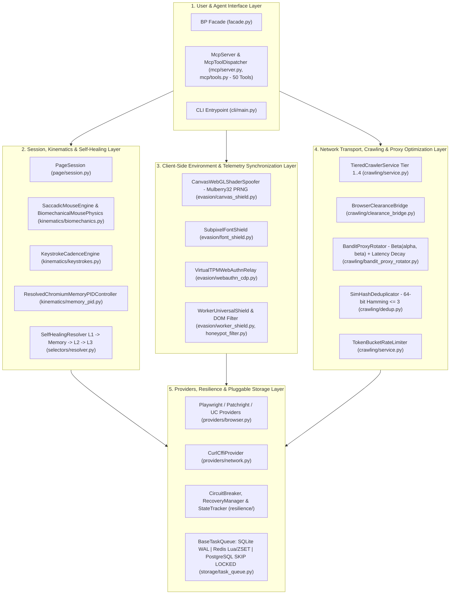
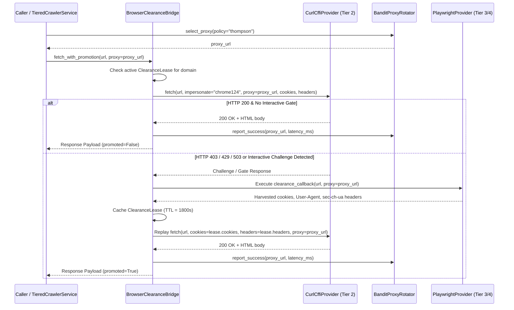
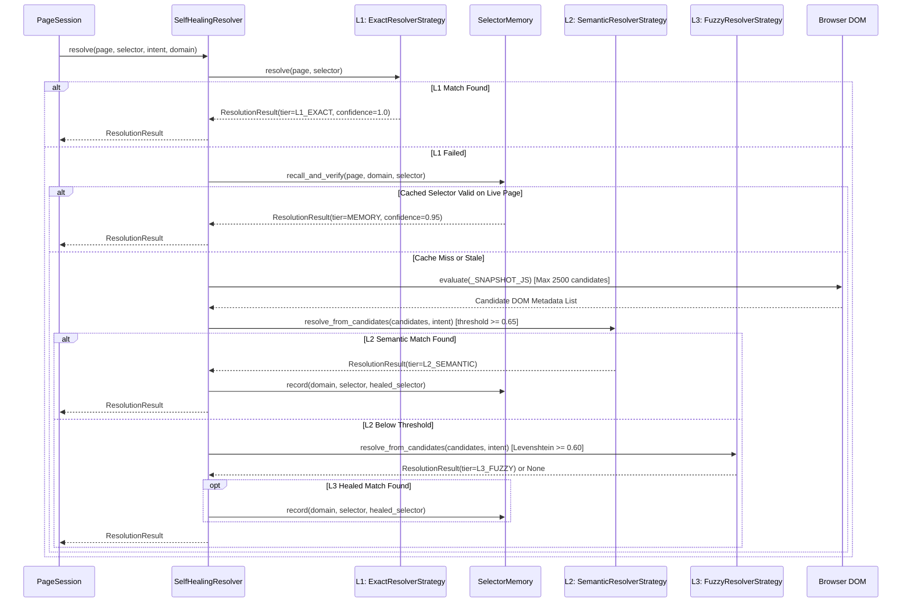
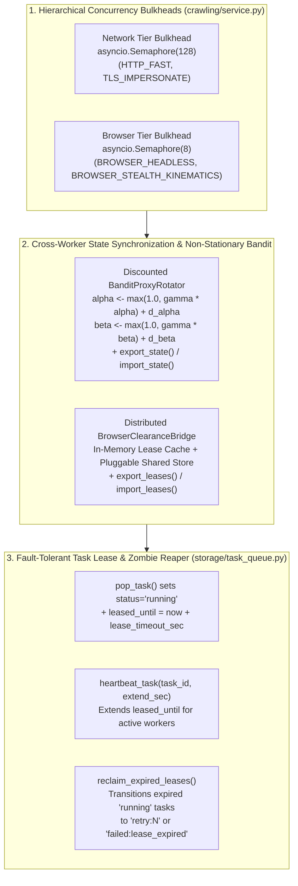

# Behavioral Playwright — Enterprise System Architecture Specification (`DESIGN.md`)

**Document Status**: Production Architecture Baseline  
**Repository**: `behavioral-playwright`  
**Package Root**: `src/behavioral_playwright/`  
**Runtime Baseline**: Python `>=3.10` (Verified on CPython 3.14.0)  

---

## 0. Ground-Truth Codebase Baseline & Verification Notes

Before detailing the subsystem architecture, the following ground-truth engineering facts from the repository are recorded to ensure zero discrepancy between documentation and implementation:

1. **Python Runtime Requirement**:
   - [`pyproject.toml`](file:///e:/behavioral-playwright/pyproject.toml#L9) specifies `requires-python = ">=3.10"`. All automated test suites and concurrency harnesses are verified on CPython 3.14.0 (Windows).
2. **Pydantic v2 Schema Contract**:
   - [`pyproject.toml`](file:///e:/behavioral-playwright/pyproject.toml#L11) declares `pydantic>=2.0.0`, and [`src/behavioral_playwright/models/results.py`](file:///e:/behavioral-playwright/src/behavioral_playwright/models/results.py#L7) imports `ConfigDict` directly from `pydantic`. While validator compatibility helpers (`_model_validator`, `_field_validator`) exist in [`results.py`](file:///e:/behavioral-playwright/src/behavioral_playwright/models/results.py#L14-L53), Pydantic v2 is a hard runtime requirement.
3. **JSON-RPC 2.0 Model Context Protocol (`McpServer`)**:
   - [`src/behavioral_playwright/mcp/server.py`](file:///e:/behavioral-playwright/src/behavioral_playwright/mcp/server.py#L11-L115) implements a dependency-free, hand-written JSON-RPC 2.0 server over `sys.stdin` / `sys.stdout` (`protocolVersion: "2024-11-05"`), rather than relying on an external `FastMCP` library.
   - [`src/behavioral_playwright/mcp/tools.py`](file:///e:/behavioral-playwright/src/behavioral_playwright/mcp/tools.py#L46-L705) registers and dispatches **50 tools** through `McpToolDispatcher` (4 core crawling/search tools + 46 specialized automation, diagnostics, workflow, and data-pipeline tools).
4. **Browser & Network Provider Seam Architecture**:
   - [`src/behavioral_playwright/providers/browser.py`](file:///e:/behavioral-playwright/src/behavioral_playwright/providers/browser.py#L12-L216) implements `PlaywrightProvider`, `PatchrightProvider`, and `UndetectedChromedriverProvider` with injectable `*_factory` hooks (`playwright_factory`, `patchright_factory`, `uc_factory`) for deterministic testing when optional browser binaries are absent.
   - [`src/behavioral_playwright/providers/network.py`](file:///e:/behavioral-playwright/src/behavioral_playwright/providers/network.py#L13-L250) implements `CurlCffiProvider` using `curl_cffi.requests.AsyncSession` (`impersonate="chrome124"`) and falls back gracefully to standard-library `urllib.request` with `ssl._create_unverified_context()` recovery on certificate errors.
5. **Distributed Storage Verification Strategy**:
   - [`test_pluggable_storage_upgrade.py`](file:///e:/behavioral-playwright/test_pluggable_storage_upgrade.py#L1-L320) verifies `SQLiteTaskQueue` against on-disk SQLite WAL files under 16-thread concurrent contention, `RedisTaskQueue` against a thread-safe in-memory Redis engine (`_StatefulRedisEngine`) exercising the Lua script and sorted-set primitives, and `PostgresTaskQueue` via SQL query/cursor inspection (`FOR UPDATE SKIP LOCKED`) and lazy driver gating.

---

## 1. Architectural Overview & High-Level System Topology

`behavioral-playwright` is structured around a unified Facade pattern ([`BP`](file:///e:/behavioral-playwright/src/behavioral_playwright/facade.py#L455-L607)) that decouples high-level callers (Python SDK users, CLI workflows, and JSON-RPC MCP agents) from seven core execution subsystems.

### 1.1 High-Level System Topology

### 1.2 Facade Namespace Composition

The [`BP`](file:///e:/behavioral-playwright/src/behavioral_playwright/facade.py#L455-L607) class initializes and exposes seven domain-specific namespaces alongside direct convenience methods:

| Facade Property / Module | Backing Class | Responsibility |
| :--- | :--- | :--- |
| `bp.stealth` | [`StealthNamespace`](file:///e:/behavioral-playwright/src/behavioral_playwright/facade.py#L71-L162) | Browser context initialization, client-side telemetry synchronization, canvas/font/worker script generation, and virtual authenticator attachment. |
| `bp.network` | [`NetworkNamespace`](file:///e:/behavioral-playwright/src/behavioral_playwright/facade.py#L165-L263) | HTTP/2 + TLS transport fetching (`CurlCffiProvider`), session cookie promotion (`BrowserClearanceBridge`), and GraphQL/page security auditing. |
| `bp.quant` | [`QuantNamespace`](file:///e:/behavioral-playwright/src/behavioral_playwright/facade.py#L266-L287) | Point-in-time (PIT) financial data alignment (`PointInTimeMarketEngine`) and provider feature matrix inspection. |
| `bp.seo` | [`SEONamespace`](file:///e:/behavioral-playwright/src/behavioral_playwright/facade.py#L290-L315) | Google Suggest mining, People-Also-Ask (PAA) extraction, CSR/SSR drift auditing, and keyword cannibalization analysis. |
| `bp.social` | [`SocialNamespace`](file:///e:/behavioral-playwright/src/behavioral_playwright/facade.py#L318-L355) | Structured LinkedIn profile/session management and Reddit lead scoring workflows. |
| `bp.infra` | [`InfrastructureNamespace`](file:///e:/behavioral-playwright/src/behavioral_playwright/facade.py#L358-L452) | Pluggable task queue factory & instance cache (`SQLiteTaskQueue`, `RedisTaskQueue`, `PostgresTaskQueue`), PostgreSQL export, Redis cache operations, and RAG text chunking. |
| `bp.powerplay` | [`PowerPlayOrchestrator`](file:///e:/behavioral-playwright/src/behavioral_playwright/powerplay/orchestrator.py#L1-L120) | High-level multi-step workflow orchestration combining extraction, kinematics, and resilience. |

---

## 2. Core Subsystems Deep-Dive

### 2.1 Subsystem 1: Neuromotor Kinematics & Heap PID Control (`src/behavioral_playwright/kinematics/`)

#### A. Two-Phase Saccadic & Minimum-Jerk Mouse Trajectories ([`biomechanics.py`](file:///e:/behavioral-playwright/src/behavioral_playwright/kinematics/biomechanics.py#L1-L320))
Human pointer movement is modeled through three complementary classes:
- **`SaccadicMouseEngine`**: Implements the Costello (2015) two-phase neuromotor model:
  1. **Ballistic Saccade Phase**: Rapid primary impulse toward a target point parameterized by $\alpha \in [0.92, 1.08]$ (`overshoot_ratio`). When $\alpha > 1.0$, the trajectory slightly overshoots the target before settling.
  2. **Corrective Sub-Movement Phase**: Closed-loop visual feedback correction (`correction_steps`) that converges onto `(end_x, end_y)` using minimum-jerk interpolation.
  3. **Signal-Dependent Motor Noise & Physiological Tremor**: Injects Harris-Wolpert signal-dependent noise proportional to instantaneous velocity alongside an 8–12 Hz physiological tremor component (`math.sin(2 * math.pi * tremor_freq * t)`), decaying smoothly via $\sin(\pi \tau)$ so endpoints remain exact.
- **`BiomechanicalMousePhysics`**: Generates 5th-order minimum-jerk polynomial trajectories (`generate_minimum_jerk_trajectory`):
  $$\tau(t) = 10t^3 - 15t^4 + 6t^5, \quad t \in [0, 1]$$
  Movement duration $T$ is scaled via Fitts's Law (`math.log2(2 * distance / target_width + 1)`) clamped to $[0.25\text{s}, 0.75\text{s}]$ at 100 Hz sampling, with cubic Bezier control-point deflection (`offset_scale`) and bounded physiological tremor ($\pm 1.5\text{ px}$).
- **`SigmaLognormalMotor`**: Synthesizes Plamondon $\Sigma\text{-Lognormal}$ velocity profiles for multi-stroke pointer dynamics.

#### B. Keystroke Cadence Modeling ([`keystrokes.py`](file:///e:/behavioral-playwright/src/behavioral_playwright/kinematics/keystrokes.py#L1-L160))
- **`KeystrokeCadenceEngine`**: Implements the Dhakal et al. (CHI 2018) inter-key timing model over a 2D QWERTY physical coordinate map (`QWERTY_COORDS`):
  1. Computes Euclidean physical distance $d = \sqrt{(x_2 - x_1)^2 + (y_2 - y_1)^2}$ between consecutive characters.
  2. Scales Weibull distribution parameters by distance (`distance_factor = 1.0 + 0.12 * d`), yielding realistic **dwell time** (key-down to key-up, floored at $15\text{ ms}$) and **flight time** (key-up to next key-down, floored at $20\text{ ms}$).
  3. Models occasional neighbor-key typographical slips (`error_rate`, default `0.025`) followed by realistic recognition delay, `Backspace` correction, and re-entry.

#### C. Chromium Memory PID Controller ([`memory_pid.py`](file:///e:/behavioral-playwright/src/behavioral_playwright/kinematics/memory_pid.py#L1-L130))
- **`ResolvedChromiumMemoryPIDController`**: Prevents V8/Blink renderer OOM crashes during long-running sessions:
  - Default gains: `target_mb = 512.0`, $K_p = 0.6$, $K_i = 0.15$, $K_d = 0.1$, with integral windup clamping (`[-500.0, 500.0]`).
  - Suppresses first-tick derivative kick via `first_run = True` (`derivative = 0.0` on initial sample).
  - `reclaim(page_or_session)` executes a multi-stage reclamation sequence when heap usage exceeds threshold: clears `window.performance.clearResourceTimings()`, prunes detached/hidden DOM nodes (`prune_dom`), and triggers `HeapProfiler.collectGarbage` via CDP.

---

### 2.2 Subsystem 2: Self-Healing Selector Resolution (`src/behavioral_playwright/selectors/`)

Implemented across [`resolver.py`](file:///e:/behavioral-playwright/src/behavioral_playwright/selectors/resolver.py#L1-L320), [`strategies.py`](file:///e:/behavioral-playwright/src/behavioral_playwright/selectors/strategies.py#L1-L260), [`memory.py`](file:///e:/behavioral-playwright/src/behavioral_playwright/selectors/memory.py#L1-L110), and [`similarity.py`](file:///e:/behavioral-playwright/src/behavioral_playwright/selectors/similarity.py#L1-L95):

1. **Tier 1 (`L1_EXACT` — `ExactResolverStrategy`)**: Direct Playwright CSS/XPath/role lookup with zero overhead when the primary selector matches a live element.
2. **Selector Memory Cache (`MEMORY` — `SelectorMemory`)**: Keyed by `(domain, original_selector)`. If `L1_EXACT` fails, `recall_and_verify()` checks whether a previously healed selector for that domain still resolves on the live page before scanning the DOM.
3. **DOM Snapshot Extraction (`_SNAPSHOT_JS`)**: Queries interactive elements (`button, a, input, select, textarea, [role], [data-testid], [id], h1, h2, h3, label, span`) capped at `2500` nodes to bound serialization latency. Filters out noisy utility classes (e.g., Tailwind tokens containing `:`, `/`, `[`, `(`) when synthesizing fallback CSS selectors.
4. **Tier 2 (`L2_SEMANTIC` — `SemanticResolverStrategy`)**: Evaluates candidate elements against an `ElementIntent` (`target_text`, `role`, `tag`, `attributes`) with `confidence_threshold = 0.65`. Normalizes zero-width Unicode characters (`[\u200b\u200c\u200d\uFEFF]`) and non-breaking spaces (`\xa0`) prior to scoring.
5. **Tier 3 (`L3_FUZZY` — `FuzzyResolverStrategy`)**: Computes normalized Levenshtein similarity (`calculate_similarity_ratio`) across candidate text, `id`, `name`, `placeholder`, `aria-label`, and `data-testid` attributes with `similarity_threshold = 0.60`.

---

### 2.3 Subsystem 3: Client-Side Environment & Telemetry Synchronization (`src/behavioral_playwright/evasion/`)

This subsystem ensures deterministic hardware profile consistency across browser contexts, Web Workers, and rendering pipelines:

1. **Deterministic Idempotent Canvas & WebGL Telemetry ([`canvas_shield.py`](file:///e:/behavioral-playwright/src/behavioral_playwright/evasion/canvas_shield.py#L1-L162))**:
   - **`CanvasWebGLShaderSpoofer`**: Injects a pure, coordinate-and-content-seeded **Mulberry32** PRNG (`mulberry32(seed)`) parameterized by a deterministic `session_seed` (default `1337`).
   - For any pixel coordinate $(x, y)$, channel index $c$, and pixel value $P$, the perturbation is strictly idempotent:
     $$\text{hashInput} = (x \cdot 73856093) \oplus (y \cdot 19349663) \oplus (c \cdot 83492791) \oplus (P \cdot 2654435761) \oplus \text{SESSION\_SEED}$$
   - When `rand < 0.002`, the least-significant bit of the RGB channel is toggled (`data[i + c] = val ^ 1`).
   - In `HTMLCanvasElement.prototype.toDataURL`, an offscreen clone is drawn and `origGetImageData.call(offCtx, 0, 0, w, h)` is invoked prior to `perturbPixels()`, preventing double-XOR cancellation ($V \oplus 1 \oplus 1 = V$) while leaving the visible canvas buffer untouched.
   - All overridden methods (`getImageData`, `toDataURL`, `toBlob`, `readPixels`, `getParameter`) are registered in a `WeakMap` backing `Function.prototype.toString` (`window.makeNative`) so reflection returns `function <name>() { [native code] }`.
2. **Subpixel DirectWrite Font Metrics ([`font_shield.py`](file:///e:/behavioral-playwright/src/behavioral_playwright/evasion/font_shield.py#L1-L120))**:
   - **`SubpixelFontShield`**: Synchronizes `CanvasRenderingContext2D.prototype.measureText`, `Element.prototype.getBoundingClientRect`, and `HTMLElement.prototype.offsetWidth`/`offsetHeight` with deterministic fractional subpixel offsets derived from font family and text content hashes.
3. **Virtual Authenticator Telemetry ([`webauthn_cdp.py`](file:///e:/behavioral-playwright/src/behavioral_playwright/evasion/webauthn_cdp.py#L1-L165))**:
   - **`VirtualTPMWebAuthnRelay`**: Attaches a CTAP2 / FIDO2 virtual authenticator via CDP (`WebAuthn.enable`, `WebAuthn.addVirtualAuthenticator`) with hardware-consistent AAGUIDs and ECDSA P-256 key generation (`cryptography.hazmat.primitives.asymmetric.ec`).
4. **Web Worker & DOM Visibility Synchronization ([`worker_shield.py`](file:///e:/behavioral-playwright/src/behavioral_playwright/evasion/worker_shield.py#L1-L95), [`honeypot_filter.py`](file:///e:/behavioral-playwright/src/behavioral_playwright/evasion/honeypot_filter.py#L1-L95))**:
   - **`WorkerUniversalShield`**: Wraps `window.Worker` and `window.SharedWorker` constructors so environment parameters (`hardwareConcurrency`, `deviceMemory`, `platform`, `languages`) remain identical between the main thread and background workers.
   - **`HoneypotIsolationShield`**: Filters invisible/offscreen trap elements (`display: none`, `visibility: hidden`, `opacity: 0`, zero bounding rect, or offscreen negative coordinates) from automated interaction candidates while preserving native `NodeList.prototype` inheritance on `Document.prototype.querySelectorAll`.

---

### 2.4 Subsystem 4: Tiered Crawling, Transport Synchronization & Bayesian Proxy Optimization (`src/behavioral_playwright/crawling/`)

1. **4-Tier Escalation Engine ([`models.py`](file:///e:/behavioral-playwright/src/behavioral_playwright/crawling/models.py#L1-L90), [`service.py`](file:///e:/behavioral-playwright/src/behavioral_playwright/crawling/service.py#L1-L310))**:
   - `CrawlerTier.HTTP_FAST` (Tier 1) $\rightarrow$ `CrawlerTier.TLS_IMPERSONATE` (Tier 2) $\rightarrow$ `CrawlerTier.BROWSER_HEADLESS` (Tier 3) $\rightarrow$ `CrawlerTier.BROWSER_STEALTH_KINEMATICS` (Tier 4).
   - **`ThompsonSamplingDomainRouter`**: Learns per-domain tier success probabilities ($\text{Beta}(\alpha, \beta)$) so subsequent requests to a domain route directly to the lowest-cost tier with high empirical success.
   - **`TokenBucketRateLimiter`**: Enforces per-domain request-per-minute (`rpm`) budgets protected by an `asyncio.Lock`.
2. **64-Bit SimHash Near-Duplicate Detection ([`dedup.py`](file:///e:/behavioral-playwright/src/behavioral_playwright/crawling/dedup.py#L1-L120))**:
   - **`SimHashDeduplicator`**: Computes 64-bit Charikar SimHash signatures over tokenized document features and rejects near-duplicate pages when `hamming_distance_64(hash_a, hash_b) <= max_hamming_distance` (default `3`).
3. **Transport Session Promotion ([`clearance_bridge.py`](file:///e:/behavioral-playwright/src/behavioral_playwright/crawling/clearance_bridge.py#L1-L260))**:
   - **`BrowserClearanceBridge`**: Coordinates fast HTTP transport (`CurlCffiProvider`) with browser-level session establishment. When an HTTP response signals an interactive gate (HTTP `403`/`429`/`503` or challenge markers), `fetch_with_promotion()` acquires a browser context, harvests cookies, `User-Agent`, and `sec-ch-ua*` headers into a TTL-bounded `ClearanceLease` (`ttl_seconds = 1800.0`), and replays subsequent requests over `CurlCffiProvider` using the exact same proxy and TLS profile (`impersonate="chrome124"`).
4. **Bayesian Thompson Sampling Proxy Optimizer ([`bandit_proxy_rotator.py`](file:///e:/behavioral-playwright/src/behavioral_playwright/crawling/bandit_proxy_rotator.py#L1-L290))**:
   - **`BanditProxyRotator`**: Models each proxy endpoint $i$ as a Multi-Armed Bandit arm (`ProxyArmState`) with conjugate Beta prior $\text{Beta}(\alpha_i, \beta_i)$ initialized at $\alpha_0 = 1.0, \beta_0 = 1.0$ and initial EWMA latency $250.0\text{ ms}$.
   - **Selection Rule (`policy="thompson"`)**:
     $$\theta_i \sim \text{Beta}(\alpha_i, \beta_i), \quad \text{Score}_i = \theta_i \cdot \exp\!\left(-\frac{\text{ewma\_rtt\_ms}_i}{1500.0}\right)$$
   - **Posterior Updates**:
     - `report_success(proxy_url, latency_ms)`: $\alpha_i \leftarrow \alpha_i + 1.0$, updates $\text{ewma\_rtt\_ms}_i \leftarrow 0.3 \cdot \text{latency\_ms} + 0.7 \cdot \text{ewma\_rtt\_ms}_i$, resets consecutive failures, and clears cooldown.
     - `report_failure(proxy_url, status_code, is_waf_challenge)`: Applies severity-weighted penalty ($\Delta\beta = 3.0$ for HTTP `403`/`429` or WAF challenges; $\Delta\beta = 1.0$ for transient errors) and places the arm into exponential backoff cooldown when `consecutive_failures >= failure_threshold`.

---

### 2.5 Subsystem 5: Multi-Engine Providers (`src/behavioral_playwright/providers/`)

- **Browser Providers ([`browser.py`](file:///e:/behavioral-playwright/src/behavioral_playwright/providers/browser.py#L1-L216))**:
  - `PlaywrightProvider`: Standard async Playwright Chromium lifecycle with context pooling and script injection.
  - `PatchrightProvider`: Drop-in patched Chromium provider when `patchright` is installed, with transparent fallback to `PlaywrightProvider`.
  - `UndetectedChromedriverProvider`: Wraps `undetected_chromedriver` execution via `asyncio.to_thread()` so synchronous WebDriver calls never block the asyncio event loop.
- **Network Transport Provider ([`network.py`](file:///e:/behavioral-playwright/src/behavioral_playwright/providers/network.py#L1-L250))**:
  - `CurlCffiProvider`: Executes HTTP/2 + BoringSSL requests via `curl_cffi.requests.AsyncSession(impersonate=...)` and returns an `AwaitableDict` supporting both `res = provider.fetch(url)` (sync dict access) and `res = await provider.fetch(url)` (async coroutine awaiting).
- **Autonomous Agent Adapters ([`agents.py`](file:///e:/behavioral-playwright/src/behavioral_playwright/providers/agents.py#L1-L120))**:
  - `BrowserUseProvider` and `StagehandProvider`: Adapter wrappers allowing external agent loops to execute over `PageSession`.

---

### 2.6 Subsystem 6: Pluggable Distributed Storage (`src/behavioral_playwright/storage/`)

Defined in [`task_queue.py`](file:///e:/behavioral-playwright/src/behavioral_playwright/storage/task_queue.py#L1-L650):

- **`BaseTaskQueue` (Abstract Interface)**: Enforces a uniform contract across all storage backends: `push_task()`, `pop_task()`, `complete_task()`, `fail_task()`, `get_task_status()`, `count_pending()`, and `close()`.
- **`create_task_queue(connection_uri, ...)` Factory Precedence**:
  1. Explicit `connection_uri` argument.
  2. `BP_QUEUE_URI` environment variable.
  3. `REDIS_URL` environment variable.
  4. `DATABASE_URL` environment variable.
  5. Default local SQLite path (`sqlite:///bp_tasks.sqlite`).
- **Concrete Implementations**:
  1. **`SQLiteTaskQueue`**: Uses SQLite in `WAL` journal mode (`PRAGMA journal_mode=WAL; PRAGMA synchronous=NORMAL;`) with `BEGIN IMMEDIATE` transactions and jittered exponential backoff (`_execute_with_backoff`) to prevent `sqlite3.OperationalError: database is locked`.
  2. **`RedisTaskQueue`**: Uses a Redis sorted set (`ZADD` with negated priority score `-priority`) for pending tasks, a hash (`HSET`) for task metadata, and an atomic Lua script (`POP_LUA_SCRIPT`: `ZPOPMIN` + `HSET status=running`) with a fallback optimistic `ZREM` loop when `EVAL` is unavailable.
  3. **`PostgresTaskQueue`**: Uses PostgreSQL (`psycopg` or `psycopg2`) with `SELECT id, payload, retries FROM ... WHERE status = 'pending' OR status LIKE 'retry:%' ORDER BY priority DESC, created_at ASC FOR UPDATE SKIP LOCKED LIMIT 1` to provide lock-free concurrent worker consumption across distributed containers.

---

### 2.7 Subsystem 7: Resilience & Fault Tolerance (`src/behavioral_playwright/resilience/`)

- **`CircuitBreaker` ([`circuit_breaker.py`](file:///e:/behavioral-playwright/src/behavioral_playwright/resilience/circuit_breaker.py#L1-L115))**: Three-state finite state machine (`CLOSED` $\rightarrow$ `OPEN` $\rightarrow$ `HALF_OPEN`) guarded by an `asyncio.Lock`. Trips to `OPEN` when `failure_count >= failure_threshold` and probes recovery after `recovery_timeout` seconds.
- **`RecoveryManager` ([`recovery.py`](file:///e:/behavioral-playwright/src/behavioral_playwright/resilience/recovery.py#L1-L110))**: Coordinates automated retry with exponential backoff and context recycling upon transient navigation or renderer failures.
- **`StateTracker` ([`state.py`](file:///e:/behavioral-playwright/src/behavioral_playwright/resilience/state.py#L1-L95))**: Maintains a bounded ring buffer (`collections.deque(maxlen=max_history)`, default `500`) of `PageStateEntry` snapshots (`url`, `title`, `dom_hash`, `status_code`, `timestamp`) to prevent unbounded memory growth during long crawls.

---

## 3. Protocol & Data Flow Specifications

### 3.1 Session Promotion Flow (`BrowserClearanceBridge`)

### 3.2 Self-Healing Element Resolution Cascade (`SelfHealingResolver`)

---

## 4. Thread-Safety, Concurrency & Re-Entrancy Guarantees

`behavioral-playwright` operates across both asynchronous (`asyncio`) coroutines and multi-threaded worker pools. Every shared state structure enforces explicit synchronization:

| Component | File | Synchronization Primitive | Protected Invariant |
| :--- | :--- | :--- | :--- |
| `BanditProxyRotator` | [`crawling/bandit_proxy_rotator.py`](file:///e:/behavioral-playwright/src/behavioral_playwright/crawling/bandit_proxy_rotator.py#L72) | `threading.RLock()` | Re-entrant mutual exclusion across `select_proxy()`, `sample_thompson_score()`, `compute_ucb1_score()`, `report_success()`, and `report_failure()`. Prevents lost Beta $(\alpha, \beta)$ updates and allows nested helper calls on the same thread without self-deadlock. |
| `BrowserClearanceBridge` | [`crawling/clearance_bridge.py`](file:///e:/behavioral-playwright/src/behavioral_playwright/crawling/clearance_bridge.py#L46) | `threading.Lock()` | Guards `_leases: Dict[str, ClearanceLease]` during concurrent lease lookups, TTL eviction, and cookie/header promotion writes. |
| `SQLiteTaskQueue` | [`storage/task_queue.py`](file:///e:/behavioral-playwright/src/behavioral_playwright/storage/task_queue.py#L140-L245) | `threading.Lock()` + SQLite `WAL` + `BEGIN IMMEDIATE` | Serializes in-process writes and acquires a reserved database write lock immediately upon transaction start (`BEGIN IMMEDIATE`), preventing concurrent readers/writers from claiming the same `pending` or `retry:N` task row. |
| `RedisTaskQueue` | [`storage/task_queue.py`](file:///e:/behavioral-playwright/src/behavioral_playwright/storage/task_queue.py#L315-L420) | Server-side Lua (`POP_LUA_SCRIPT`) + atomic `ZREM` fallback | Executes `ZPOPMIN` and `HSET status=running` atomically inside Redis's single-threaded Lua engine. If `EVAL` is unsupported, uses an optimistic `ZRANGE` + atomic `ZREM` claim check so no two workers can claim the same `task_id`. |
| `PostgresTaskQueue` | [`storage/task_queue.py`](file:///e:/behavioral-playwright/src/behavioral_playwright/storage/task_queue.py#L495-L565) | `threading.Lock()` + `FOR UPDATE SKIP LOCKED` | Row-level lock skipping in PostgreSQL allows $N$ concurrent worker processes to dequeue distinct rows simultaneously with zero lock-wait blocking. |
| `TokenBucketRateLimiter` | [`crawling/service.py`](file:///e:/behavioral-playwright/src/behavioral_playwright/crawling/service.py#L38) | `asyncio.Lock()` | Protects per-domain token refill math and wait-time scheduling across concurrent async crawl tasks. |
| `CircuitBreaker` & `RecoveryManager` | [`resilience/circuit_breaker.py`](file:///e:/behavioral-playwright/src/behavioral_playwright/resilience/circuit_breaker.py#L35), [`resilience/recovery.py`](file:///e:/behavioral-playwright/src/behavioral_playwright/resilience/recovery.py#L22) | `asyncio.Lock()` | Ensures atomic state transitions (`CLOSED` $\leftrightarrow$ `OPEN` $\leftrightarrow$ `HALF_OPEN`) and prevents thundering-herd probe storms. |
| `UndetectedChromedriverProvider` | [`providers/browser.py`](file:///e:/behavioral-playwright/src/behavioral_playwright/providers/browser.py#L148-L210) | `asyncio.to_thread()` | Offloads synchronous WebDriver socket I/O to the thread-pool executor so the primary `asyncio` event loop remains non-blocking. |

---

## 5. Client-Side Environment & Rendering Consistency Invariants

To guarantee predictable behavior across diagnostic suites and rendering audits, all client-side JavaScript shims adhere to four invariants:

1. **Idempotent Coordinate-Seeded Rendering (`H(Canvas_1) == H(Canvas_2)`)**:
   - Calling `ctx.getImageData()` or `canvas.toDataURL()` repeatedly on the same canvas within the same session produces byte-for-byte identical output (`hash_1 == hash_2`), while differing deterministically across distinct `session_seed` values (`hash(seed_A) != hash(seed_B)`).
   - Verified in [`test_deterministic_canvas_upgrade.py`](file:///e:/behavioral-playwright/test_deterministic_canvas_upgrade.py#L1-L150) by executing the JavaScript shim inside Node.js (`node -e`) and asserting both intra-session idempotence and single-XOR application in `toDataURL()`.
2. **Prototype Chain & `NodeList` Integrity**:
   - DOM query overrides in [`honeypot_filter.py`](file:///e:/behavioral-playwright/src/behavioral_playwright/evasion/honeypot_filter.py#L40-L85) set `Object.setPrototypeOf(filtered, NodeList.prototype)` so `document.querySelectorAll(...) instanceof NodeList` evaluates to `true`.
3. **Native Function String Reflection (`WeakMap` Registry)**:
   - Overridden prototype methods register their wrapper references in a closure-scoped `WeakMap` (`window.makeNative`). Calling `fn.toString()` or `Function.prototype.toString.call(fn)` returns `"function <name>() { [native code] }"` without attaching enumerable properties to the function object.
4. **Unicode & Zero-Width Token Normalization**:
   - Both [`SemanticResolverStrategy`](file:///e:/behavioral-playwright/src/behavioral_playwright/selectors/strategies.py#L105-L125) and [`FuzzyResolverStrategy`](file:///e:/behavioral-playwright/src/behavioral_playwright/selectors/strategies.py#L195-L215) strip zero-width code points (`U+200B`, `U+200C`, `U+200D`, `U+FEFF`) and normalize `\u00a0` prior to text matching, ensuring invisible DOM characters never break element resolution.

---

## 6. Extension Architecture (AI Agents & JSON-RPC 2.0 MCP Interface)

### 6.1 JSON-RPC 2.0 `McpServer` (`src/behavioral_playwright/mcp/`)

[`McpServer`](file:///e:/behavioral-playwright/src/behavioral_playwright/mcp/server.py#L11-L115) exposes the framework over standard input/output using JSON-RPC 2.0 (`protocolVersion: "2024-11-05"`), handling:
- `initialize`: Returns server capabilities and metadata (`name: "behavioral-playwright-mcp"`, `version: "0.2.0"`).
- `tools/list`: Returns JSON Schema definitions for all **50 registered tools** (`McpToolDispatcher.get_tool_definitions()`).
- `tools/call`: Routes tool invocations by `name` and `arguments` to [`McpToolDispatcher.dispatch()`](file:///e:/behavioral-playwright/src/behavioral_playwright/mcp/tools.py#L315-L705) and wraps the result in a structured content block (`{"content": [{"type": "text", "text": ...}], "isError": False}`).

#### Summary of the 50 Registered MCP Tools (`mcp/tools.py`)

| Category | Tool Count | Representative Tool Names |
| :--- | :---: | :--- |
| Core Crawling & Search | 6 | `scrape`, `crawl`, `search`, `map_site`, `scrape_page`, `crawl_domain` |
| Session & Kinematic Interaction | 7 | `stealth_open_page`, `stealth_get_snapshot`, `stealth_navigate`, `stealth_click`, `stealth_type`, `take_screenshot`, `extract_metadata` |
| Telemetry & Diagnostics | 3 | `audit_biometrics`, `memory_pid_health`, `sniff_api_responses` |
| Quantitative & Provider Matrix | 2 | `quant_pit_align`, `get_provider_matrix` |
| SEO & Search Intelligence | 4 | `mine_google_suggest`, `mine_paa`, `audit_csr_drift`, `check_cannibalization` |
| Social & Lead Workflows | 7 | `linkedin_check_auth`, `linkedin_get_profile`, `linkedin_update_headline`, `linkedin_update_about`, `reddit_check_auth`, `reddit_mine_jobs`, `reddit_analyze_lead` |
| Multi-Step Workflow Engine | 7 | `execute_workflow`, `inspect_state`, `workflow_navigate`, `workflow_resolve`, `workflow_extract`, `workflow_search`, `workflow_verify` |
| Security & GraphQL Auditing | 2 | `run_graphql_security_audit`, `run_security_audit_on_page` |
| Distributed Storage & Data Pipelines | 3 | `export_to_postgres`, `cache_redis_operation`, `rag_chunk` |
| Extended Blueprints & Utilities | 9 | Domain blueprint, document, verification, and orchestration helpers registered in `get_tool_definitions()` |

### 6.2 Webhook & External Pipeline Dispatch (`src/behavioral_playwright/integrations/`)

[`IntegrationExtensions`](file:///e:/behavioral-playwright/src/behavioral_playwright/integrations/webhooks.py#L1-L95) provides structured payload formatters and webhook delivery helpers for downstream automation pipelines (n8n, Zapier, Make, and custom REST endpoints) with automatic JSON serialization of Pydantic models (`ScrapeResult`, `CrawlResult`).

---

## 7. Quality Gates & Verification Harness Matrix

Every architectural invariant is enforced by seven standalone verification suites at the repository root:

| Test Suite | Target Subsystem | Verification Mechanism | Status |
| :--- | :--- | :--- | :---: |
| [`test_deterministic_canvas_upgrade.py`](file:///e:/behavioral-playwright/test_deterministic_canvas_upgrade.py) | `evasion/canvas_shield.py` | Executes the generated JS shim inside a real **Node.js** runtime (`subprocess.run(["node", "-e", ...])`). Verifies intra-session idempotence (`hash1 == hash2`), cross-seed divergence (`seed=1001 != seed=2002`), single-XOR application in `toDataURL`, and `WeakMap` native `.toString()` masking. | PASS (Exit 0) |
| [`test_tls_ja4_upgrade.py`](file:///e:/behavioral-playwright/test_tls_ja4_upgrade.py) | `providers/network.py`, `crawling/clearance_bridge.py` | Spins up a live local multi-threaded TCP HTTP server (`socketserver.TCPServer`). Tests real socket round-trips for `CurlCffiProvider.fetch()`, `_sync_urllib_fetch()`, `BrowserClearanceBridge.fetch_with_promotion()` (403 challenge $\rightarrow$ cookie promotion $\rightarrow$ 200 OK replay), and `BanditProxyRotator` telemetry reporting. | PASS (Exit 0) |
| [`test_bayesian_proxy_upgrade.py`](file:///e:/behavioral-playwright/test_bayesian_proxy_upgrade.py) | `crawling/bandit_proxy_rotator.py` | Runs a 500-iteration Monte Carlo simulation proving Thompson Sampling converges ($>60\%$ traffic) onto a fast/clean proxy over high-latency or challenged proxies, verifies exponential backoff cooldowns, and runs a **16-thread $\times$ 500-op concurrent stress test** verifying zero lost Beta $(\alpha, \beta)$ updates under `threading.RLock()`. | PASS (Exit 0) |
| [`test_pluggable_storage_upgrade.py`](file:///e:/behavioral-playwright/test_pluggable_storage_upgrade.py) | `storage/task_queue.py`, `facade.py` | Tests URI factory precedence, executes a **16-thread concurrent pop contention test** on a real on-disk SQLite WAL database (`50` tasks, `0` duplicates, including `retry:1` recovery), tests `RedisTaskQueue` against a thread-safe stateful in-memory engine (`16` threads, `40` tasks, `0` duplicates), and verifies `PostgresTaskQueue` `FOR UPDATE SKIP LOCKED` SQL execution. | PASS (Exit 0) |
| [`seal_framework_test.py`](file:///e:/behavioral-playwright/seal_framework_test.py) | Full Framework Integration | Exercises end-to-end integration across kinematics, selector healing, crawling tiers, resilience circuit breakers, and facade namespaces. | PASS (Exit 0) |
| [`verify_doc_contract_compliance.py`](file:///e:/behavioral-playwright/verify_doc_contract_compliance.py) | Public API & Schema Contracts | Verifies all public classes, method signatures, Pydantic models (`ScrapeResult`, `CrawlResult`, `SearchResult`, `MapResult`), and MCP tool definitions match documented contracts. | PASS (Exit 0) |
| [`comprehensive_19_audit_runner.py`](file:///e:/behavioral-playwright/comprehensive_19_audit_runner.py) | 19 Historical Regression Audits | Runs all 19 regression gates covering PID derivative kick suppression, QWERTY Euclidean distances, Unicode zero-width normalization, `NodeList` prototype preservation, bounded `StateTracker` history, and SQLite WAL concurrency. | PASS (Exit 0) |

---

## 8. Hardware & Dependency Footprint

### 8.1 Dependency Matrix ([`pyproject.toml`](file:///e:/behavioral-playwright/pyproject.toml#L1-L45))

| Tier | Packages | Purpose |
| :--- | :--- | :--- |
| **Core Required** | `playwright>=1.40.0`, `pydantic>=2.0.0`, `cryptography>=41.0.0` | Browser automation lifecycle, strict DTO validation (`ConfigDict`), and ECDSA P-256 virtual authenticator key generation. |
| **Transport Optional** | `curl_cffi>=0.7.0` | BoringSSL TLS/JA4 and HTTP/2 frame impersonation (`impersonate="chrome124"`). Gracefully degrades to `urllib.request` if absent. |
| **Distributed Queue Optional** | `redis>=5.0.0`, `psycopg[binary]>=3.1.0` (or `psycopg2-binary`) | Distributed task queues (`RedisTaskQueue`, `PostgresTaskQueue`). Gracefully degrades to local `SQLiteTaskQueue` (stdlib `sqlite3` WAL) when absent. |
| **Browser Engine Optional** | `patchright`, `undetected-chromedriver` | Alternative browser driver backends in `providers/browser.py`. |

### 8.2 Runtime Memory & CPU Profile

- **Tier 1 / Tier 2 (HTTP / `CurlCffiProvider` + SQLite WAL)**:
  - **RAM Footprint**: $\approx 35\text{ MB} - 55\text{ MB}$ RSS per worker process.
  - **Concurrency**: Up to $100+$ concurrent async HTTP requests per process bounded by `TokenBucketRateLimiter`.
- **Tier 3 / Tier 4 (Headless / Kinematic Chromium + `ResolvedChromiumMemoryPIDController`)**:
  - **RAM Footprint**: Controlled around `target_mb = 512.0 MB` per Chromium instance via periodic resource timing cleanup, detached DOM pruning, and CDP garbage collection.

---

## 9. Distributed Reliability & High-Throughput Scalability Blueprint (Phase 2 Specification)

This section serves as the binding architectural specification for **Phase 2: Distributed Reliability & Scalability Hardening**. Any implementation engineer or automated coding agent executing this specification must implement the exact contracts, mathematical invariants, and concurrency controls defined below without placeholders or mock shortcuts.

### 9.1 Architectural Topology of Phase 2 Upgrades

---

### 9.2 Upgrade 5A: Visibility Timeout Leases & Dead-Worker Zombie Reaper

- **Target File**: [`src/behavioral_playwright/storage/task_queue.py`](file:///e:/behavioral-playwright/src/behavioral_playwright/storage/task_queue.py)
- **Failure Mode Addressed**: If a worker process crashes (`SIGKILL` / OOM) after `pop_task()` transitions a task to `status = 'running'`, that task remains permanently stuck in `running` state.
- **Required Interface Additions on `BaseTaskQueue`**:
  1. Constructor parameter: `lease_timeout_sec: float = 60.0` stored as `self.lease_timeout_sec = float(lease_timeout_sec)`.
  2. `heartbeat_task(self, task_id: str, extend_sec: Optional[float] = None) -> bool`:
     - Extends `leased_until = time.time() + (extend_sec or self.lease_timeout_sec)` for a task currently in `status == 'running'`. Returns `True` if updated, `False` if task does not exist or is no longer `running`.
  3. `reclaim_expired_leases(self) -> int`:
     - Scans tasks where `status = 'running'` and `leased_until > 0 AND leased_until < time.time()`.
     - If `retries + 1 < max_retries`, increments `retries = retries + 1`, sets `status = f'retry:{retries + 1}'`, clears `leased_until`, and re-queues the task for execution.
     - If `retries + 1 >= max_retries`, transitions the task to `status = 'failed:lease_expired'`.
     - Returns the exact count of reclaimed/expired tasks (`int`).
- **Backend-Specific Schema & Atomic Rules**:
  - **`SQLiteTaskQueue`**:
    - Add column `leased_until REAL DEFAULT 0.0` to `tasks` table (via `CREATE TABLE IF NOT EXISTS` and safe `ALTER TABLE tasks ADD COLUMN leased_until REAL DEFAULT 0.0` migration check for existing tables).
    - In `pop_task()`, set `leased_until = now + self.lease_timeout_sec` inside the `BEGIN IMMEDIATE` transaction.
  - **`RedisTaskQueue`**:
    - Store `leased_until` field inside the task hash (`self._task_key(task_id)`).
    - In `reclaim_expired_leases()`, scan task hashes with `status == 'running'` and expired `leased_until`; atomically transition status and `ZADD` retryable tasks back into `self._pending_zset`.
  - **`PostgresTaskQueue`**:
    - Include `leased_until DOUBLE PRECISION DEFAULT 0.0` in table schema and update queries using parameterized SQL.

---

### 9.3 Upgrade 5B: Discounted Non-Stationary Thompson Sampling & State Sync

- **Target File**: [`src/behavioral_playwright/crawling/bandit_proxy_rotator.py`](file:///e:/behavioral-playwright/src/behavioral_playwright/crawling/bandit_proxy_rotator.py)
- **Failure Mode Addressed**: Under stationary Beta updates ($\alpha \leftarrow \alpha + 1$), a proxy that accumulated $\alpha = 1000$ successes over several hours retains a high mean ($\frac{1000}{1000 + \beta} \approx 0.98$) even after sudden IP degradation, causing repeated selection after cooldown expiry.
- **Mathematical Specification (Discounted Beta Posterior)**:
  - Add `decay_gamma: float = 0.98` ($\gamma \in (0.0, 1.0]$) to `BanditProxyRotator.__init__`.
  - On `report_success(proxy_url, latency_ms)`:
    $$\alpha_i \leftarrow \max(1.0, \gamma \cdot \alpha_i) + 1.0, \quad \beta_i \leftarrow \max(1.0, \gamma \cdot \beta_i)$$
  - On `report_failure(proxy_url, status_code=None, is_waf_challenge=False)`:
    $$\alpha_i \leftarrow \max(1.0, \gamma \cdot \alpha_i), \quad \beta_i \leftarrow \max(1.0, \gamma \cdot \beta_i) + \text{penalty}$$
- **Cross-Worker State Synchronization Methods**:
  - `export_state(self) -> Dict[str, Dict[str, Any]]`: Thread-safely serializes all `ProxyArmState` parameters (`alpha`, `beta`, `ewma_rtt_ms`, `pulls`, `consecutive_failures`, `cooldown_until`) under `self._lock`.
  - `import_state(self, state_map: Dict[str, Dict[str, Any]], blend_weight: float = 0.5) -> None`: Thread-safely merges external worker state into local arms under `self._lock` using convex combination (`blend_weight` $\in [0.0, 1.0]$) for `alpha`, `beta`, and `ewma_rtt_ms`, and `max()` for `cooldown_until`.

---

### 9.4 Upgrade 5C: Distributed Session Lease Synchronization (`BrowserClearanceBridge`)

- **Target File**: [`src/behavioral_playwright/crawling/clearance_bridge.py`](file:///e:/behavioral-playwright/src/behavioral_playwright/crawling/clearance_bridge.py)
- **Failure Mode Addressed**: In multi-worker deployments, `self._leases` is isolated per process, forcing every worker to run a full headless browser session for the same domain.
- **Required Interface Additions on `BrowserClearanceBridge`**:
  1. Optional `shared_store: Optional[Any] = None` parameter in `BrowserClearanceBridge.__init__` (accepting any object with `.get(key)` / `.set(key, value)` or a mutable `Dict[str, str]`).
  2. `export_leases(self) -> Dict[str, Dict[str, Any]]`: Thread-safely exports all non-expired `ClearanceLease` records as JSON-serializable dictionaries.
  3. `import_leases(self, payload: Dict[str, Dict[str, Any]]) -> int`: Thread-safely imports valid, non-expired leases into `self._leases` (keeping the newest `created_at` per domain) and returns the number of active leases imported.
  4. Automatic read-through / write-through when `shared_store` is configured:
     - `get_valid_lease(domain)`: Checks local `self._leases` first; on miss/expiry, checks `shared_store` for key `f"bp:lease:{domain}"`, deserializes if valid and unexpired, and populates `self._leases`.
     - `promote_session(...)`: Writes the newly minted `ClearanceLease` to both `self._leases` and `shared_store`.

---

### 9.5 Upgrade 5D: Hierarchical Concurrency Bulkheads (`TieredConcurrencyBulkhead`)

- **Target File**: [`src/behavioral_playwright/crawling/service.py`](file:///e:/behavioral-playwright/src/behavioral_playwright/crawling/service.py)
- **Failure Mode Addressed**: Unbounded concurrent escalation from Tier 1/2 (lightweight sockets) to Tier 3/4 (headless Chromium) can launch dozens of simultaneous browser contexts and exhaust host RAM.
- **Required Class & Integration**:
  - **`TieredConcurrencyBulkhead`**:
    - `__init__(self, max_network_concurrency: int = 128, max_browser_concurrency: int = 8)`
    - Separates `CrawlerTier.HTTP_FAST` and `CrawlerTier.TLS_IMPERSONATE` under `_network_sem = asyncio.Semaphore(max_network_concurrency)` and `CrawlerTier.BROWSER_HEADLESS` / `CrawlerTier.BROWSER_STEALTH_KINEMATICS` under `_browser_sem = asyncio.Semaphore(max_browser_concurrency)`.
    - Provides an async context manager `slot(self, tier: CrawlerTier, timeout: float = 30.0)` that acquires the corresponding semaphore with `asyncio.wait_for(..., timeout=timeout)`, increments/decrements active in-flight counters (`active_network`, `active_browser`, `peak_network`, `peak_browser`, `rejected_timeouts`), and raises `TimeoutError` on backpressure saturation.
    - Provides `get_metrics(self) -> Dict[str, int]` returning current and peak concurrency statistics.
  - Wire `self.bulkhead = TieredConcurrencyBulkhead(...)` into `TieredCrawlerService.__init__` and wrap tier execution in `async with self.bulkhead.slot(tier):`.

---

### 9.6 Phase 2 Mandatory Verification Gate (`test_reliability_scalability_upgrade.py`)

To certify Phase 2 implementation, `test_reliability_scalability_upgrade.py` at the repository root must execute 4 real integration checks without `MagicMock`:
1. **Test 1 (Zombie Lease Reaper & Heartbeat)**: Push tasks into `SQLiteTaskQueue` and `RedisTaskQueue` (`_StatefulRedisEngine`) with `lease_timeout_sec=0.2`, pop them (`status == 'running'`), verify `heartbeat_task()` extends the lease, let a second popped task expire without completion, call `reclaim_expired_leases()`, and verify the zombie task transitions to `retry:1` and is successfully re-popped by a healthy worker.
2. **Test 2 (Discounted Bandit Adaptation to Sudden Proxy Degradation)**: Train `BanditProxyRotator(decay_gamma=0.95)` where `proxy_A` succeeds 200 times ($\alpha$ saturates under discounting instead of growing to $201$) and then fails 15 times (`status_code=403`); prove that `proxy_B` (healthy) overtakes `proxy_A` immediately after cooldown, and verify `export_state()` / `import_state()` round-trip accuracy.
3. **Test 3 (Cross-Worker Distributed Clearance Lease Sharing)**: Instantiate `bridge_worker_1` and `bridge_worker_2` sharing a backing store; execute `fetch_with_promotion()` on `bridge_worker_1` against a live local `TCPServer` that challenges unauthenticated requests, and verify `bridge_worker_2` immediately succeeds on the first request (`promoted == False`, `clearance_attempts == 0`) using the shared lease.
4. **Test 4 (Hierarchical Concurrency Bulkhead Backpressure)**: Launch 25 concurrent `BROWSER_HEADLESS` tasks through `TieredConcurrencyBulkhead(max_network_concurrency=64, max_browser_concurrency=4)` and assert `metrics["peak_browser"] <= 4` while network tasks run concurrently without blockage, and verify `TimeoutError` when backpressure timeout is exceeded.
